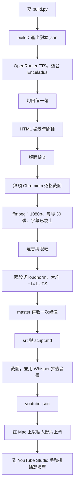

# 機器學習從零開始：補習影片產線

這是一套把「一集腳本」做成 YouTube 影片的工具。對象是完全沒學過機器學習的人。旁白是台灣華語的合成語音，畫面是暗色的架構圖，字幕燒在畫面上。

到 2026-10-30 已經做了 **24 支**：EP00–EP20，加上實戰 A1、A2 上、A2 下。

你以後要做的事只有兩種：寫新的一集，或在畫面引擎加一種新的圖。兩種都走 `windows-kit/`。`legacy/` 是當天試過的舊工具，留著對照，不要拿來做新的一集。

更細的說明在 [docs/](docs/README.md)。安裝與錯誤對照在 [windows-kit/README.md](windows-kit/README.md)。當天每個檔案在做什麼，寫在 [INVENTORY.md](INVENTORY.md)（英文；裡面的 `engine/` 現在是 `legacy/`）。

## 整條流程



配音用 OpenRouter 的 `google/gemini-3.8-flash-tts`，voice 是 **Enceladus**。金鑰放在你自己電腦的 `.env`，變數名稱是 `OPENROUTER_API_KEY`。

## 目錄

| 位置 | 你會不會常改 |
|---|---|
| `windows-kit/` | 會。這是做片的程式：安裝、TTS、畫面、ffmpeg |
| `episodes/` | 會。每一集的 `build.py` 和已經生成的文字（沒有 mp4／wav） |
| `docs/` | 加了新效果或新步驟時，把說明補上 |
| `scripts/` | 下載字型、下載 lemo-opuscar |
| `upload/` | 上傳用的標題、說明、小腳本 |
| `coverage/` | 講義每一頁有沒有被某一集講到 |
| `notes/` | 為什麼選這個聲音、整季打算講什麼 |
| `legacy/` | 舊管線。新集不要從這裡開始 |

## 快速開始

字型要先下載（大約 23 MB，沒有放進 git），否則中文會用到備援字體，每台電腦看起來不一樣：

```bash
bash scripts/fetch_fonts.sh
```

```powershell
powershell -NoProfile -ExecutionPolicy Bypass -File scripts\fetch_fonts.ps1
```

來源是官方 Noto CJK（SIL OFL 1.1）。說明在 `windows-kit/assets/fonts/FONTS_NOT_INCLUDED.md`。

### Windows（主要的做片環境，NVIDIA 顯示卡 + NVENC）

需要 Windows 10/11、網路（只有安裝和配音）、ffmpeg。有 NVIDIA 顯示卡時，Whisper 可以用 GPU，編碼可以用 NVENC。沒有顯示卡也能做完，只是比較慢。

1. 把這個倉庫放在你要的位置。下面用 `D:\ml-video-kit` 代表 `windows-kit` 這個資料夾。放在別的路徑也可以。
2. 在那個資料夾開 PowerShell：

   ```powershell
   powershell -NoProfile -ExecutionPolicy Bypass -File .\setup.ps1
   # 讓 Whisper 用 NVIDIA GPU：
   powershell -NoProfile -ExecutionPolicy Bypass -File .\setup.ps1 -Cuda
   ```

   或雙擊 `setup.cmd`。它會用 uv 裝 Python 3.11 到 `.venv`（不動系統裡別的 Python）、`npm ci`、下載 Chromium 到 `.browsers\`、檢查 ffmpeg、預先下載 Whisper small 到 `.cache\`，並從 `.env.example` 做出 `.env`。
3. 打開 `.env`，把 `OPENROUTER_API_KEY=your-key-here` 換成你的金鑰。不要加引號。金鑰向 [OpenRouter](https://openrouter.ai/keys) 申請。`.env` 不要 commit。

做一集（桌機上當天就是這樣跑的，會用 NVENC 和 CUDA）：

```powershell
cd D:\ml-video-kit
.\make_episode.cmd D:\路徑\episodes\ep21 --nvenc --whisper-device cuda
```

`run_ep.cmd` 會把上面這串步驟寫進紀錄。它使用腳本自己所在的資料夾；若要指定別的位置，設環境變數 `ML_VIDEO_KIT`。

有 NVENC 時一次只渲染一集（消費級驅動的工作階段有上限）。`queue1.ps1`、`queue2.ps1`、`queue3.ps1` 就是在排隊。

### Linux / macOS

```bash
cd windows-kit
bash setup.sh          # 有 NVIDIA、想讓 Whisper 用 GPU：bash setup.sh --cuda
# 編輯 .env，填上 OPENROUTER_API_KEY
./make_episode.sh /path/to/episodes/ep21
```

沒有 ffmpeg 時：Debian／Ubuntu 用 `sudo apt install -y ffmpeg`，macOS 用 `brew install ffmpeg`。macOS 當天沒有實機跑過，步驟與 Linux 相同。

8 核心、記憶體大約 15 GB 的機器，渲染工人不要超過 2 個，否則 Chromium 截圖會逾時：

```bash
./make_episode.sh /path/to/episodes/ep21 --workers 2
```

### 先確認工具本身

`windows-kit/episodes/sample` 是大約 40 秒、3 個場景的小範例。它的旁白 wav **沒有**放在 git 裡，所以第一次跑 `tts` 需要金鑰，花費大約 0.01 美元。只想看畫面、不想配音：

```powershell
.\make_episode.cmd episodes\sample build timeline stills
```

預覽圖在 `episodes\sample\qc\pre\`。

## 寫一集新的

在 `episodes/ep21/` 放一個 `build.py`。`L()` 是一句旁白（也是字幕），`E()` 是一個畫面元素，`at=` 表示它跟著哪一句出現。

```python
from lib import Ep

ep = Ep(21, "標題", "", "一段摘要，會進 YouTube 說明。", ["機器學習", "機器學習從零開始"], "下集預告")
E = ep.E
L = ep.L

ep.scene("title", "", noHeader=True, chapter="開場", desc="標題卡")
E("titlecard", ep="EP21", title="這集的標題", sub="一句副標")
L("嗨，歡迎回到機器學習補習班。這是第二十一集。")

ep.scene("idea", "先看一個例子", chapter="直覺", desc="先講人話", ref="講義頁碼")
a = L("想像你在整理衣櫃，先把很不像的衣服分開。")
b = L("這個動作叫做分類。", "這個動作叫做分類。", gap=0.4)
E("card", x=150, y=240, w=700, h=140, title="先講人話", col="A", at=a)
E("card", x=1000, y=240, w=700, h=140, title="再給名稱", col="B", at=b)

ep.save(".")
```

然後：

```powershell
.\make_episode.cmd D:\路徑\episodes\ep21 build timeline stills
```

看過預覽，再拿掉步驟名稱，讓它從配音做到 `youtube.json`。欄位、顏色、表格和決策樹的寫法在 [docs/episode-format.md](docs/episode-format.md)。整集範例看 `windows-kit/episodes/ep13-example/build.py`。

EP00–EP10 是較早的 `src.py`，這套畫面引擎讀不了。要改那些集，先改寫成 `build.py`。

## 加一種新的畫面

1. 打開 `windows-kit/engine/engine.js`，照著現有的 `R.card`、`R.text` 加一個 `R.你的名字 = (t, e, a) => { ... }`。
2. 畫字時用檔案裡已經有的 `T()`，版面檢查才看得到這個字。
3. 在 `build.py` 寫 `E("你的名字", ..., at=某一句)`。
4. 跑 `build timeline stills`，看 `qc/pre/` 和 `qc/layout.txt`。
5. 在 [docs/episode-format.md](docs/episode-format.md) 的元素表加一列。

逐步說明在那份文件的「加一種新的畫面元素」。

## 出片前檢查

- [ ] `qc/layout.txt`：沒有不能接受的出界、重疊、或字掉進字幕區
- [ ] 自己聽開頭、中間、結尾。Whisper 常把「信」聽成「性」、「序章」聽成「續章」，那是辨識同音，用耳朵為準
- [ ] `qc/loudness.json` 大約 −14 LUFS，真峰值不高過 −1 dBTP。`mux` 若警告沒有對到 −14，一定要跑 `master`
- [ ] `youtube.json` 沒有磁碟路徑、沒有金鑰
- [ ] 標題、標籤、說明不要寫學校名稱

完整清單在 [docs/rendering-qc.md](docs/rendering-qc.md)。

## 上傳

上傳在 Mac 上做，程式不在這個倉庫裡。影片設成**私人**。播放清單在 YouTube Studio 用瀏覽器排（API 權限只有上傳）。

1. 把 mp4、`upload/epNN_desc.txt`、`upload/meta.json` 放到收件匣。預設是 `~/Documents/roy-ai-editor/yt_inbox`，可用 `YT_INBOX` 改。
2. `bash upload/run_ep.sh NN --dry-run`，確認沒有被學校名稱檢查擋下。
3. `bash upload/do_ep.sh NN` 才真的傳。成功後腳本會刪掉收件匣裡的 mp4。

這個倉庫是公開的，`upload/youtube_uploads.json` 裡的影片 ID 是 `REDACTED-…` 佔位符，不是真實網址。真實 ID 留在上傳那台電腦。細節見 [docs/upload-playlist.md](docs/upload-playlist.md)。

## 已知問題與小技巧

| 狀況 | 怎麼處理 |
|---|---|
| OpenRouter 一直 HTTP 429 | 程式會自己等再試。中斷後重跑同一個指令，錄好的句子不會重錄。一集大約 15 個請求 |
| 某一場景切句失敗（`alignment failed`、空的 argmin、Whisper 相符度 0） | 讓它落到逐句重錄，或整集加 `--tts-mode line`。EP17 就是這樣做完的 |
| 截圖逾時 `Timeout 30000ms` | 機器太忙。8 核心那類機器，渲染工人總數維持 2 個以內 |
| NVENC 失敗，或同時開兩集渲染失敗 | 消費級驅動的 NVENC 有工作階段上限。一次只渲染一集，工人數降到 5 以下，或拿掉 `--nvenc` |
| 響度不是 −14 | 先確認有跑 `mix` 的限幅，再跑 `master`。Gemini 的峰值偏高，不能只靠 mux |
| `av` 升到 19 之後 Whisper 報 `metadata_errors` | 把 `av` 留在 19 以下。`requirements.txt` 已寫 `av>=12,<19` |
| Whisper 對同步的分數偏低，但耳朵覺得沒問題 | 同音字誤判。聽原句再決定要不要重錄 |
| Windows 無法覆寫 mp4 | 播放器還開著。關掉再跑。當掉的渲染可能留下 `out\video.mp4.lock`，確認沒有渲染在跑再刪 |

## 字型與 lemo-opuscar

- **字型**：DejaVu Sans Mono 已經在 `windows-kit/assets/fonts/`。Noto Sans CJK TC 用上面的 `scripts/fetch_fonts` 下載，不要 commit 那兩個 woff2。
- **lemo-opuscar**（MIT）負責無頭瀏覽器截圖。沒有整份放進倉庫，釘在 commit `f17136060781a0068a7951245a3aa7835a7230de`。套件裡的 `windows-kit/render/` 是改過的副本，授權全文在 `windows-kit/licenses/lemo-opuscar-MIT.txt`。要抓上游時跑 `scripts/fetch_lemo_opuscar.sh`（Windows 用同名的 `.ps1`）。說明見 [docs/lemo-opuscar.md](docs/lemo-opuscar.md)。

## 維護

改程式、加效果、送出之前看 [CONTRIBUTING.md](CONTRIBUTING.md)。版本紀錄在 [CHANGELOG.md](CHANGELOG.md)。下一季可能做的集數在 [docs/roadmap.md](docs/roadmap.md)。
