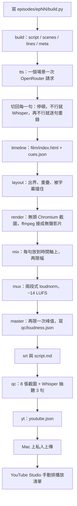

# 產線架構

這一頁是 **v1**（機器學習從零開始）。**v2**（系統與軟體安全）在 [`pipeline/v2/`](../pipeline/v2/README.md)，算圖時仍呼叫下面這套 `windows-kit`。

這套工具把一集「機器學習從零開始」從腳本做到可以上傳的成片。成片是 **1920×1080、每秒 30 張、字幕燒在畫面上、響度大約 −14 LUFS**。旁白是合成語音，`youtube.json` 會標 `synthetic: true`。

v1 的入口是 `windows-kit/make_episode.py`。2026-10-30 用過的另外四套工具在 `legacy/`，對照用，見 [legacy/README.md](../legacy/README.md)。

## 一步一步

下面的名字是套件裡的步驟。舊管線的步驟對得上，只是檔名不同。



| 步驟 | 做什麼 | 你會看到的檔 |
|---|---|---|
| `build` | 執行該集的 `build.py` | `script.json`、`lines.json`、`scenes.json`、`meta.json` |
| `tts` | 場景文字送給 OpenRouter，再切成每句一個 wav | `voice/l000.wav`…、`voice/dur.json`、`voice/costs.json`、`voice/manifest.json` |
| `timeline` | 依每句長度排時間，寫出網頁 | `film/index.html`、`film/timeline.js`、`film/main.js`、`cues.json` |
| `layout` | 在每句開始後 0.9 秒、結束前 0.05 秒看文字框 | `qc/layout.txt`（只有警告，不擋出片） |
| `render` | 幾個 Chromium 各畫一段，JPEG 送給 ffmpeg，最後無損接起來 | `out/video.mp4`（還沒有聲音） |
| `mix` | 每句 wav 放在它的 t0，再過限幅器 | `out/mix.wav`、`out/mix_lim.wav` |
| `mux` | 畫面加聲音，兩段式響度 | `epNN.mp4` |
| `master` | 再處理峰值，AAC 192k，faststart | 原地更新 `epNN.mp4`，`qc/loudness.json` |
| `srt` | 由 cues 做字幕，重疊的會裁開 | `epNN.srt` |
| `md` | 帶 `[mm:ss]` 的可讀腳本 | `script.md` |
| `qc` | 8 張畫面，Whisper small 聽 3 句 | `qc/f*.jpg`、`qc/sync.json` |
| `yt` | 標題、說明、章節、標籤 | `youtube.json` |
| `stills` | 不在預設流程裡。每個場景結尾一張圖，寫畫面時很好用 | `qc/pre/` |

做完的步驟會在該集的 `.kit/` 留記號。同一個指令再跑一次，會從還沒做完的地方繼續。你在指令裡寫出步驟名稱時，那些步驟會重做。

時間軸的預設節奏（可用該集的 `pace.json` 改，例如 `{"line": 0.7, "scene": 1.2}`）：

- 第一句從 1.2 秒開始
- 句與句之間再空 0.7 秒，另外加上那句自己的 `gap`
- 換場景再空 1.2 秒
- 全片長度 = 最後一句結束時間 + 2.5 秒

畫面是一張 1920×1080 的 canvas。字幕由 `engine.js` 畫在畫面下方，所以成片裡的字幕是燒進去的，另外仍會輸出 `.srt`。

## 目錄

```
windows-kit/          v1 的主路徑（安裝、做片、畫面引擎都在這。v2 算圖也呼叫它）
  kit/                Python：Ep、TTS、切句、數字念法
  render/             由 lemo-opuscar 改來的截圖與編碼（附 MIT 授權）
  engine/engine.js    暗色架構圖的畫面元素
  episodes/sample     約 40 秒的煙霧測試腳本
pipeline/v2/          系統與軟體安全這一季的腳本、對齊、錄屏、QC
episodes/             EP00–EP20、epA1、epA2 的腳本與小的文字產物（沒有影音）
upload/               YouTube 標題、說明、上傳小工具
coverage/             講義頁面有沒有被某一集講到（不含講義本身）
notes/                聲音選擇、整季規劃、當天進度
legacy/               舊管線 A/B/C/D
docs/                 這些說明
scripts/              下載字型、下載 lemo-opuscar
```

`episodes/epA1` 與 `episodes/epA2/p1`、`p2` 在桌機上還有 cues、script.md、youtube.json。整理時沒有複製到。要補，在裝好套件之後對那幾個資料夾跑 `timeline md yt`。

## 舊管線差在哪

四套舊工具和套件是同一個設計，差別在切句和有沒有最後的 master。

| | 切句 | 備註 |
|---|---|---|
| A | 場景配音後對齊 | EP00、02–05。`src.py` 格式 |
| C | 先用能量切，不行就逐句重錄 | 改過的場景才重錄。渲染工人建議 2 |
| B | Whisper 對齊 | `build.py` + `lib.Ep` |
| D | 先用停頓切 | 多了 master、`pace.json`，以及「記憶體不夠就先等」 |
| windows-kit | 停頓 → Whisper → 重錄一次 → 逐句 | 把 D 的步驟和 B/D 的畫面引擎收在一起 |

## 環境變數（套件）

金鑰只放在 `windows-kit/.env`。`make_episode.py` 會讀它，而且不會把值印出來。

| 變數 | 作用 |
|---|---|
| `OPENROUTER_API_KEY` | 配音必填 |
| `KIT_WORKERS` | 渲染工人數。沒寫就用 `min(8, CPU 執行緒÷4, 記憶體 GB÷6)` |
| `KIT_NVENC=1` | 用 NVIDIA `h264_nvenc` |
| `KIT_WHISPER_DEVICE` | `cpu`、`cuda` 或 `auto` |
| `KIT_TTS_VOICE` | 預設 `Enceladus` |
| `KIT_TTS_MODEL` | 預設 `google/gemini-3.8-flash-tts` |
| `KIT_TTS_INSTRUCTIONS` | 覆寫老師語氣的英文提示 |
| `ML_VIDEO_KIT` | Windows 佇列腳本的套件目錄。沒寫就用腳本自己所在的資料夾 |
| `PLAYWRIGHT_BROWSERS_PATH` | setup 會指到套件裡的 `.browsers/` |
| `HF_HOME` | Whisper 模型。setup 會放在套件裡的 `.cache/` |

舊管線、上傳腳本的變數見 [legacy/README.md](../legacy/README.md) 和 [上傳](upload-playlist.md)。

## 依賴

- Python 3.11 最合適（3.10–3.13 可以）。套件用 uv 建 `.venv`。
- `faster-whisper` 1.2.x、`ctranslate2` 4.x、`av` **必須 < 19**、`numpy`、`soundfile`、`opencc-python-reimplemented`（Whisper 的簡體轉繁體）。
- 預覽圖需要 Pillow。`coverage/build.py` 需要 openpyxl。
- 有 NVIDIA GPU、想讓 Whisper 用 CUDA 時，setup 加 `-Cuda` / `--cuda`，會裝 `nvidia-cublas-cu12` 與 `nvidia-cudnn-cu12`。
- Node.js 18 以上（lemo 上游寫 20 以上）。`playwright-core` 1.63.0，瀏覽器是 `chromium-headless-shell`。
- ffmpeg 要含 ffprobe。Windows 上若要 NVENC，用含 `h264_nvenc` 的版本（setup 會試 winget 的 Gyan.FFmpeg）。

## 畫面從哪來

`windows-kit/render/*.mjs` 是 [lemo-opuscar](lemo-opuscar.md) 的小幅修改（多了 `KIT_VCODEC=nvenc` 這類）。授權全文在 `windows-kit/licenses/lemo-opuscar-MIT.txt`。暗色架構圖的元素是我們自己的 `windows-kit/engine/engine.js`，每個 `R.<type>` 就是一種畫面。
