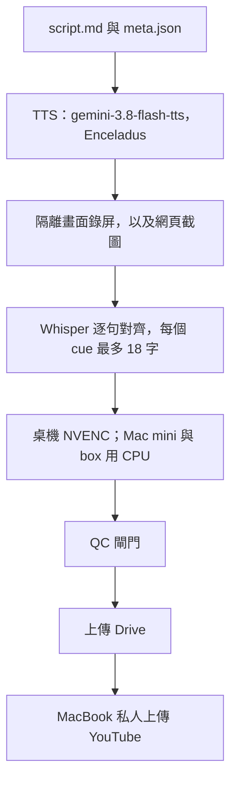

# v2：系統與軟體安全

2026-10-31 用來做「系統與軟體安全｜從零到白帽」的產線。v1（機器學習那一季）仍在 [`windows-kit/`](../../windows-kit/README.md)。v2 算圖時呼叫的還是那套畫面引擎。

已上傳的連結在 [COURSES.md](../../COURSES.md)。下一版要改的事在 [ROADMAP.md](ROADMAP.md)。

## 流程

1. 一集一個目錄：`script.md` 和 `meta.json`。格式在 [FORMAT.md](FORMAT.md)。
2. 配音用 OpenRouter 的 `google/gemini-3.8-flash-tts`，聲音 **Enceladus**。金鑰只放在桌機套件的 `.env`，變數名稱是 `OPENROUTER_API_KEY`。
3. 畫面來自兩種真的素材：隔離 X 畫面上的終端錄屏，以及真的網頁截圖（可以緩慢平移）。
4. 字幕用 Whisper，對**真實的配音**逐句強迫對齊。每個 cue 最多 18 個字。
5. 算圖：桌機用 NVENC；Mac mini 和 box 用 CPU。MacBook 只做私人 YouTube 上傳，不要在上面跑重的工作，它會過熱。
6. QC 通過之後上傳 Drive，再從 MacBook 上傳成私人影片。
7. 多台機器一起做時，先在 `STATUS.md` 認領。協定在 [STATUS.md](STATUS.md)。

指令和每一台機器的角色在 [RENDER.md](RENDER.md)。2026-10-31 14:00 的進度在 [HANDOFF.md](HANDOFF.md)。16 集的審查和 v2 字幕修正紀錄在 [REVIEW.md](REVIEW.md)。



## 開始之前

```bash
cp pipeline/v2/config.example.env pipeline/v2/config.env
# 編輯 config.env。不要 commit。不要把金鑰寫進去。
```

`config.env` 至少要有：

| 變數 | 是什麼 |
|---|---|
| `SEC_SERIES` | 每一集的工作目錄（不進 git） |
| `KIT` | v1 的 `windows-kit` 在這台機器上的路徑 |
| `OPENROUTER_API_KEY` | 只放在 `$KIT/.env`，不放在 `config.env` |

其餘變數有預設值，說明寫在範例檔裡。

## QC 閘門

不過關就不上傳。

- 同步相似度要過
- `over18 = 0`
- 沒有缺 cue
- 沒有倒置 cue
- 錄屏裡沒有別人的視窗
- 沒有黑畫面
- 片長 10–15 分鐘

## 這輪學到的

- **素材檔名只用 ASCII。** 中文檔名換機器之後會變成空畫面。
- **自動裁掉錄屏頭尾的黑幀。** 否則最後一幀停住時會停在全黑。`tools/trim_dark_tail.py` 會做這件事，`md2build_v2.py` 轉檔之後會呼叫它。
- **不要搶同一個 X 畫面。** 兩個錄屏共用一個 display 時，成片裡會出現別人的視窗。號碼分段：

  | 腳本 | 畫面 |
  |---|---|
  | `recording/record.sh` | `DISP`，預設 `:111` |
  | `recording/record78.sh` | 固定 `:78` |
  | `recording/rec_disp.sh` | `D` 必須是 91–99。要自己先準備好那個畫面 |
  | `recording/hxrec.sh` | 171–179，腳本自己開 Xvfb |
  | `recording/rec30.sh` | 181–189，腳本自己開 Xvfb |

- **對齊之後不能留下倒置 cue。** 結束時間早於開始、或長度為零，就和隔壁的 cue 合併，或按字數把那段時間重分。程式在 `align_qc/r2_align.py` 的 `_sanitize`。
- **不要切開英文字，也不要切開數字和單位。** 一個字的尾巴併回上一句。程式在 `align_qc/r2_align_v2.py` 的 `chunk_v2`。超過 18 字的單一識別字整詞保留。
- **重的工作不要放 MacBook。** 配音、Whisper、算圖會讓它過熱。它只上傳。

## 目錄

| 位置 | 內容 |
|---|---|
| `align_qc/r2_align.py` | 現行的逐句對齊。含倒置 cue 的修正 |
| `align_qc/r2_align_v2.py` | 不切開英文和數字單位的切法。`r2_align_v1.py`、`r2_align2.py`、`r2_align.pre_r3fix.py` 是較早的版本，留著對照 |
| `align_qc/r2_qc.py`、`r2_qc2.py` | 用成片音軌檢查字幕有沒有對上 |
| `align_qc/r2_pack.py` | 寫 `youtube.json` 和縮圖，並清掉路徑 |
| `align_qc/r2run_box.sh`、`r2_finish.sh` | box 上的算圖和收尾 |
| `recording/` | 每一段終端錄屏。`typer.sh` 是打字機效果。先讀 `env.sh` |
| `tools/md2build_v2.py` | `script.md` 轉成 `build.py`，並抽出錄屏影格 |
| `tools/md2build.py` | 較早的轉換，沒有把錄屏和截圖嵌進時間軸 |
| `tools/trim_dark_tail.py` | 裁黑幀。匯出裡只有呼叫，腳本是照筆記補上的 |
| `build_plan.py` | 大綱片段。匯出在第 10 集中間斷掉，只留完整的第 1–9 集 |

`tools/ready.py`、`mark.py`、`status.py` 是當天改 STATUS 表用的小工具，認的句子見 [STATUS.md](STATUS.md)。

## 這次匯出沒有帶進來的

畫面引擎的 `R.img`（截圖和影格序列）當天有打進三台算圖機器，修補檔本身不在壓縮檔裡。v1 的 `engine.js` 還沒有這個元素。`build.py` 已經會寫 `E('img', ...)`。套件補上這個元素之前，截圖和錄屏不會出現在畫面上。

套件 `kit/force_srt.py` 的同一套切字規則也是當天打上去的，修補檔不在壓縮檔裡。可執行的規則在 `r2_align_v2.py`。
